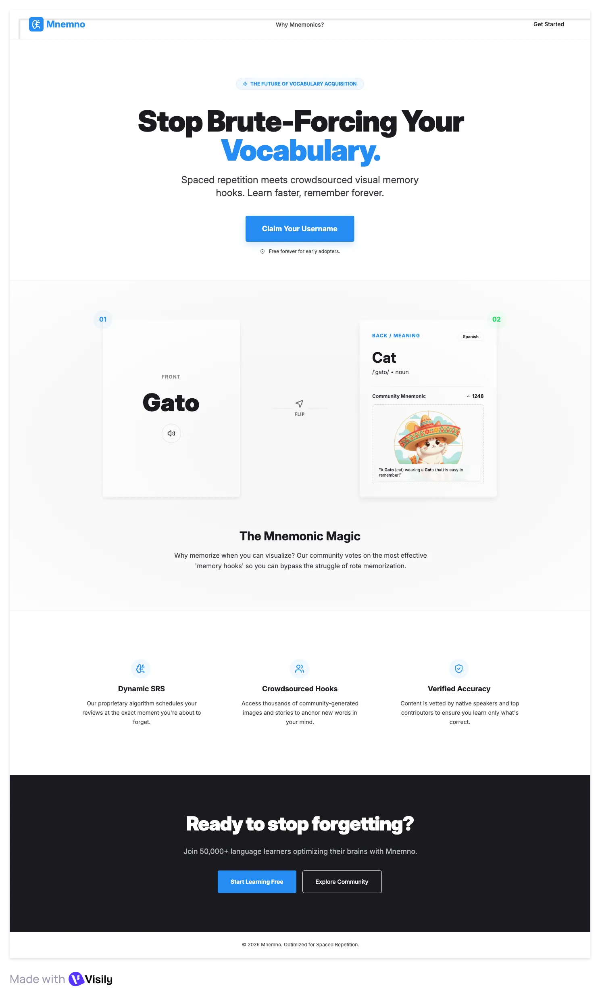
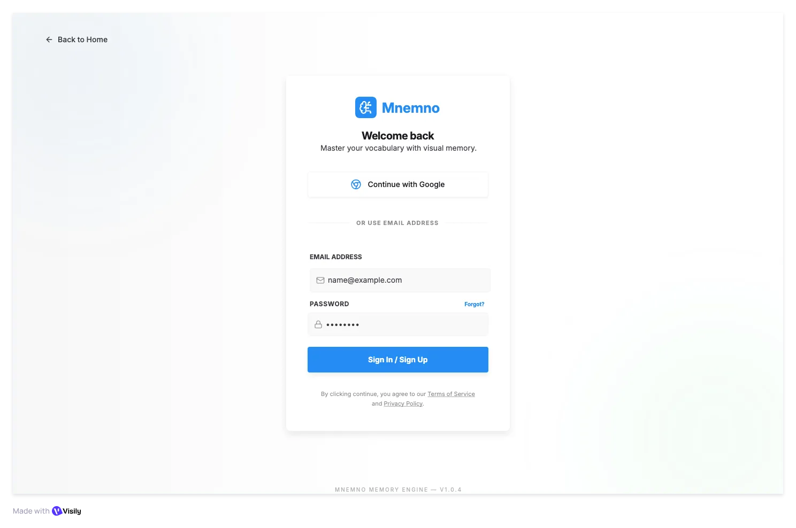
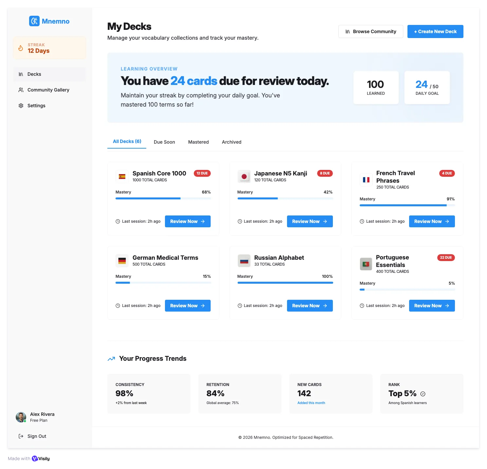
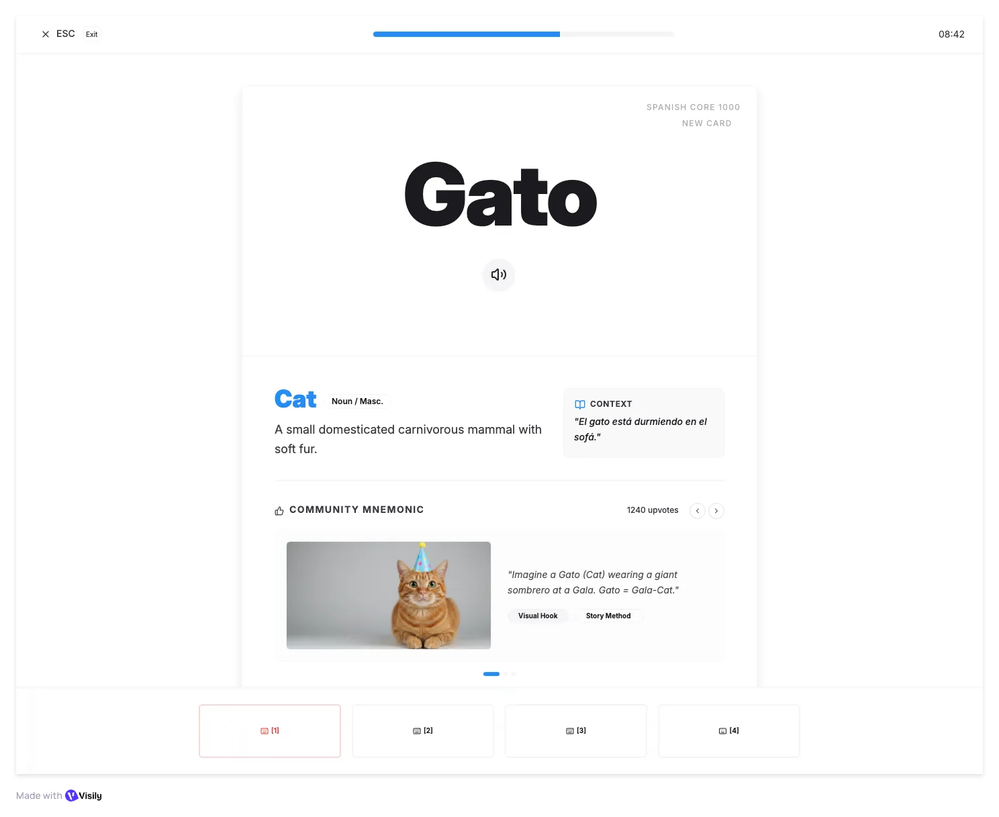

# Project & Portfolio

* **Wireframe - Milestone 2**
* **Phillip Cantu**
* **Assignment Due Date:  Jun 16, 2026**

I tested out several AI Wireframing tools including:

* [Figma AI Wireframe Generator](https://www.figma.com/solutions/ai-wireframe-generator/)
  * Which created this: [LINK](https://www.figma.com/make/PtEGZbrHHlkRa3mwHF1xRe/Desktop-Wireframe-for-Mnemno?t=umNsxAS5UEKtHBqz-1)
* [UX Pilot](https://uxpilot.ai/)
  * Which created this: [LINK](https://uxpilot.ai/s/f7ed0c6c6b6c35863b0bed4f38458a16)
* [Visily AI](https://www.visily.ai/)
  * Which created this: [LINK](https://app.visily.ai/projects/fa348b77-e23f-4e81-927d-e8898781f45a/boards/2636254)

The winner of all three was **Visily**. Not because it's "prettier" but it most closely followed the prompt ([See prompt](./prompt.txt)). 
But it also is the best rendition of the vague picture I've had in my own mind on how I'd want **Mnemno** to be. So my current chosen wireframe, of which I'll still iterate on is here: 

<https://app.visily.ai/projects/fa348b77-e23f-4e81-927d-e8898781f45a/boards/2636254>
 _publicly viewable link_

The Landing Page:

The Auth Screen:

The User Dashboard:

The Study or Review Session:

   

I feel the landing page gives a very good visual representation of what the goal of **Mnemno** is to the potential user.
Additionally, the **Study Session** is extremely close as to how I want it. With the **mnemonic** being very prominent.
