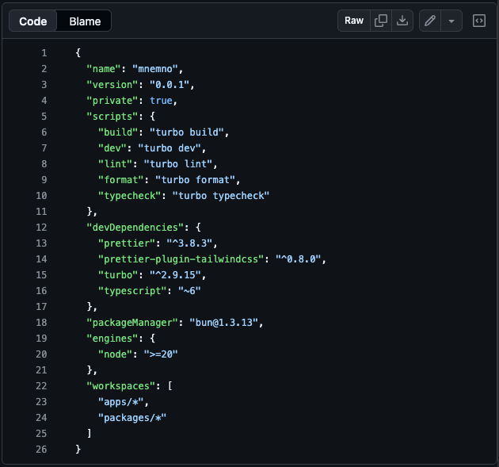
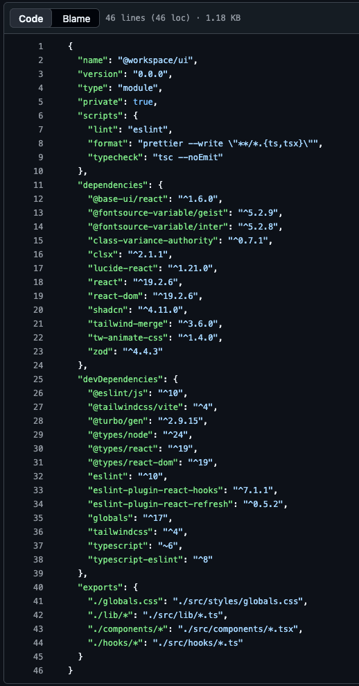
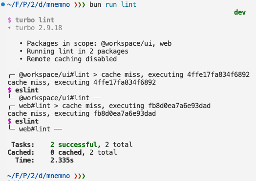
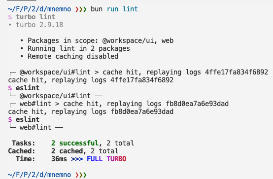

# Project & Portfolio

* **Research Notes - Milestone 6**
* **Phillip Cantu**
* **Assignment Due Date:  Jun 28, 2026**

## Main Topic - Preparing for Alpha (Component Mapping & Issue Tracking)

As I get ready to transition my project into the Alpha phase, the focus is all about turning an abstract prototype into clean, structured code. Alpha means having a working functional layout ready for review. To do this without making my codebase an absolute mess, I'm following the principles laid out in the **"Thinking in React"** guide to map out my UI.

* **Breaking Up Mockups:** Instead of just jumping in and writing raw TSX from scratch, I'm looking at my Figma designs to draw mental boxes around every block and matching them up with **shadcn/ui base primitives**. By using these clean, unstyled components as my structural building blocks, I can strictly adhere to the _"Single Responsibility Principle"_. It lets me leverage pre-built accessible behavior for layout pieces like dialogs, sidebars, or menus, and if a layout handles too much custom logic, I can easily break it down into smaller subcomponents.
* **Mapping Data to Structure:** A neat trick I noticed is that well-designed data models and UI usually share the exact same shape. My database models can directly influence how my components are structured, making the data flow a lot cleaner.
* **Component-to-GitHub-Issue Pipeline:** Once I map out my components (like a main layout containing a sidebar, card grids, or specific interactive buttons), I can file each distinct UI component as an individual issue on GitHub. This makes my development process incredibly modular. Instead of a massive, overwhelming task to "build the dashboard," I can check off bite-sized issues one pull request at a time.

### Reference Links

**React Documentation**<br />[Thinking in React](https://react.dev/learn/thinking-in-react)

**Gist Developer Reference**<br />[File Structure in Development](https://gist.github.com/eMediaLab/d2fc4989959234766926c7b618fa1b01)

**Shadcn/ui Documentation**<br />[Components](https://ui.shadcn.com/docs/components)

**Note:**<br />The "Thinking in React" guide completely changed how I look at my Figma wireframes. It bridges the gap between design and physical tasks on my GitHub project board, giving me an exact step-by-step roadmap for my Alpha build.

---

## Personal Research: Monorepos via Turborepo + ESLint

While scaffolding my workspace layout using `bunx --bun shadcn@latest init --template vite`, the CLI generated a full **monorepo** configuration automatically. This threw me for a loop at first because I couldn’t see tooling like **ESLint** inside my root `package.json`, yet running `bun run lint` spun up ESLint smoothly across multiple directories. I dug into the documentation to understand exactly how this works under the hood.

**Root's Package.json File Screenshot:**



### Workspace Dependency Scoping

A monorepo consolidates multiple apps or modular packages inside a single repository. In my root config, the `workspaces` array tells Bun where to look: Each folder under these directories is treated as its own isolated project. When I checked `packages/ui/package.json`, I realized that `eslint` and its standard plugins were explicitly managed down there. Bun handles linking all of this seamlessly, keeping the root clean while letting individual packages maintain their specific dependencies.

**`packages/ui/package.json` File Screenshot:**



### How Turborepo Automates Tasks

When I execute `bun run lint` at the root, it runs `turbo lint`. Turborepo doesn’t actually look at my code files directly; it acts as a high-performance macro manager. It searches across all my workspaces (`apps/web` and `packages/ui`) to see if they have a local `"lint"` script defined in their local configurations. If they do, it runs them in parallel.

### Content-Aware Caching & Efficiency

The coolest thing about Turbo is its smart execution system. The first time I ran the script, the logs showed a `cache miss`. Turbo fully ran the tasks and built a local snapshot hash based on file contents, environment settings, and dependencies.

**Screenshot:**



If I run it again without changing anything, Turbo returns a `cache hit` and finishes instantly, replaying the terminal output in milliseconds instead of wasting system processing cycles.

**Screenshot:**



### Modern ESLint Flat Configs (`eslint.config.js`)

Inside both `apps/web` and `packages/ui`, the project implements the modern flat configuration structure. Some critical features I unpacked include:

* `globalIgnores(['dist'])`: Keeps compiled build targets isolated so the linter doesn't waste time scanning compressed bundles.

* `tsconfigRootDir: import.meta.dirname`: Tells the TypeScript parser exactly where the local workspace `tsconfig.json` resides. This prevents linting errors from getting confused by the root directory layout or sibling projects.

### Extending ESLint

Real quick, I'd like to mention that I do plan to extend my ESLint flat configuration structure by adding even more options.

To be honest, I'll be taking lots of inspiriation from my apprenticeship work at [Hgraph](https://hgraph.com/) and from the official docs of course.

### Reference Links

**Turborepo Documentation**<br />[Introduction to Turborepo Core Concepts](https://turborepo.dev/docs)

**ESLint Guide**<br />[Configuration Files (Flat Config)](https://eslint.org/docs/latest/use/configure/configuration-files)

**ESLint Documentation**<br />[Configure ESLint](https://eslint.org/docs/latest/use/configure/)

**Note:**<br />Understanding workspace orchestration clears up a lot of magic. Now I see exactly how Turbo leverages local workspace configurations to run tasks in parallel while keeping dependencies separated and builds extremely fast. Prior to this research I never even knew a "workspaces" attribute was available to be defined within the `package.json` but it makese complete sense now.

---

## Personal Research: Modern ESLint & Navigating the Flat Config Architecture

While reviewing my new monorepo layout, as previously mentioned, I ran directly into the modern **ESLint Flat Config** paradigm (`eslint.config.js`). I ran a basic test by adding an unused array (`const myArray = []`) and it correclty threw a linting error:

```bash
...dev/mnemno/apps/web/src/App.tsx
  3:7  error  'myArray' is assigned a value but never used  @typescript-eslint/no-unused-vars
✖ 1 problem (1 error, 0 warnings)
error: script "lint" exited with code 1
└─ web#lint ──
 Tasks:    1 successful, 2 total
Cached:    0 cached, 2 total
  Time:    2.185s 
Failed:    web#lint
error: script "lint" exited with code 1
```

However, when I attempted to change this from am `error` to a `warning` by adding a custom rule to the bottom of the `eslint.config.js`,

```json
{
 rules: {
  "no-unused-vars": "warn"
 },
},
```

I was surprised to see that it not only threw double errors for the same `no-unused-vars` rule, but it added a third error:

```bash
...dev/mnemno/apps/web/src/App.tsx
  3:7  warning  'myArray' is assigned a value but never used  no-unused-vars
  3:7  error    'myArray' is assigned a value but never used  @typescript-eslint/no-unused-vars

...dev/mnemno/apps/web/src/components/theme-provider.tsx
  16:14  warning  'theme' is defined but never used  no-unused-vars

✖ 3 problems (1 error, 2 warnings)

error: script "lint" exited with code 1
└─ web#lint ──
 Tasks:    1 successful, 2 total
Cached:    1 cached, 2 total
  Time:    1.254s 
Failed:    web#lint
error: script "lint" exited with code 1
```

Naturally, I dug into the official documentation to unpack exactly how rules cascade, how `shadcn/ui` scaffolds this setup out of the box, and how to properly extend it with TypeScript.

### The Anatomy of an Autogenerated Flat Config

When I scaffolded my monorepo using `bunx --bun shadcn@latest init --template vite`, the CLI pre-configured an elegant `eslint.config.js` inside my workspaces. **The entire configuration is a single flat array of objects** evaluated from top to bottom.

A standard autogenerated block looks like this:

```js
export default defineConfig([
  globalIgnores(['dist']),
  {
    files: ['**/*.{ts,tsx}'],
    extends: [
      js.configs.recommended,
      tseslint.configs.recommended,
      reactHooks.configs.flat.recommended,
      reactRefresh.configs.vite,
    ],
    languageOptions: {
      globals: globals.browser,
      parserOptions: {
        tsconfigRootDir: import.meta.dirname,
      },
    },
  },
])
```

### The "Gotcha" with Plugin Scoping & Rule Duplication

In this new flat config system, **every object in the array is an isolated, independent entity** unless explicitly grouped. This creates two distinct traps:

* **The Duplicate Rule Bug:** If I create a brand-new object at the bottom of the array just to turn a rule into a warning (like what I did earlier with `"no-unused-vars": "warn"`), it acts as a global override that applies to **all** files. Because the core JavaScript engine is forced back on, it clashes with the TypeScript compiler. This results in getting hit with **both** a core JS warning and a `@typescript-eslint` error for the exact same line of code. Plus, again since the core JavaScript engine was forced back on (which TypeScript would usually silent), that's why the new third error appeared (there wasn't a fourth one for TS because TS was still actively running and recognized it as a non-error).
* **The Plugin Isolation Crash:** If I try to adjust a plugin-prefixed rule (like `@typescript-eslint/no-unused-vars`) inside a completely separate configuration object without re-declaring the underlying plugin engine within that exact object, ESLint completely breaks. It will throw an explicit error stating it `could not find plugin "@typescript-eslint"`, EXAMPLE:

```json
{
 rules: {
  "no-unused-vars": "warn",
  "@typescript-eslint/no-unused-vars": "warn",
 },
},
```

gave me:

```bash
Oops! Something went wrong! :(
ESLint: 10.5.0
A configuration object specifies rule "@typescript-eslint/no-unused-vars", but could not find plugin "@typescript-eslint".

Common causes of this problem include:
1. The "@typescript-eslint" plugin is not defined in your configuration file.
2. The "@typescript-eslint" plugin is not defined within the same configuration object in which the "@typescript-eslint/no-unused-vars" rule is applied.
└─ web#lint ──
 Tasks:    1 successful, 2 total
Cached:    1 cached, 2 total
  Time:    660ms 
Failed:    web#lint
```

### How to Properly Extend and Override Rules

To safely customize a modern linting workflow, overrides must be added **directly into the specific configuration object** where those file patterns and plugins are already loaded.

By nesting a custom `rules` object inside the main block that extends `tseslint.configs.recommended`, the parser maintains full context of the TypeScript plugin while safely overriding definitions:

```js {16-21}
export default defineConfig([
  globalIgnores(['dist']),
  {
    files: ['**/*.{ts,tsx}'],
    extends: [
      js.configs.recommended,
      tseslint.configs.recommended,
      reactHooks.configs.flat.recommended,
      reactRefresh.configs.vite,
    ],
    languageOptions: {
      globals: globals.browser,
      parserOptions: {
        tsconfigRootDir: import.meta.dirname,
      },
    },
    rules: {
      // 1. Turn off the base JS rule to stop duplicate reporting
      "no-unused-vars": "off",
      // 2. Safely downgrade the TypeScript rule to a warning for development
      "@typescript-eslint/no-unused-vars": "warn",
    },
  },
])

```

This ensures the linter remains incredibly fast, keeps my terminal clean, and allows me to flag compilation issues as warnings during active coding sessions before tightening them into strict errors for production.

### Dialing in Strictness for Solo Production

Even as a solo developer, relying purely on the default `recommended` array leaves a lot of gaps where buggy or unmaintainable code can slip through. To build an incredibly robust defense system for my codebase, I can inject specific, strict rule overrides into my configuration block. 

For example, while the defaults might let me get away with using `any`, I can explicitly enforce `@typescript-eslint/no-explicit-any`: "error" to force myself to write type-safe contracts. I can also activate strict rule sets that aren't turned on by default, like requiring explicit return types on functions (`@typescript-eslint/explicit-function-return-type`), forcing exact type imports to optimize build performance, or tightening up React-specific habits by banning un-escaped HTML characters. Customizing this section lets me transition my workspace from a loose development playground into a rigorous, automated gatekeeper that catches architectural mistakes before they ever make it to a pull request.

#### Example Hyper-Strict & Robust `eslint.config.js`

```js
import js from '@eslint/js'
import globals from 'globals'
import reactHooks from 'eslint-plugin-react-hooks'
import reactRefresh from 'eslint-plugin-react-refresh'
import tseslint from 'typescript-eslint'
import { defineConfig, globalIgnores } from 'eslint/config'

export default defineConfig([
  // Completely isolate build and output directories from the linter
  globalIgnores(['dist', '.turbo', 'node_modules']),
  
  {
    files: ['**/*.{ts,tsx}'],
    extends: [
      js.configs.recommended,
      tseslint.configs.recommended,
      reactHooks.configs.flat.recommended,
      reactRefresh.configs.vite,
    ],
    languageOptions: {
      globals: globals.browser,
      parserOptions: {
        tsconfigRootDir: import.meta.dirname,
      },
    },
    // strict custom rules
    rules: {
        // Allow intentional unused arguments/params if prefixed with an underscore:
        "no-unused-vars": "off",
      "@typescript-eslint/no-unused-vars": ["error", { 
        "argsIgnorePattern": "^_", 
        "varsIgnorePattern": "^_" 
      }],

      // Completely ban "any"; force strict typing or explicit unknowns:
      "@typescript-eslint/no-explicit-any": "error",
      "@typescript-eslint/explicit-function-return-type": ["error", {
        // Allows unannotated inline arrow functions like .map(i => i):
        "allowExpressions": true,
        // Allows unannotated variables if the variable definition itself is typed:
        "allowTypedFunctionExpressions": true
      }],
      // Force type-only imports to dramatically optimize tree-shaking and compilation performance:
      "@typescript-eslint/consistent-type-imports": ["error", { 
        "prefer": "type-imports" 
      }],
        // Keep disabled so TanStack Router can extend route declarations via empty interfaces
      "@typescript-eslint/no-empty-object-type": "off",
      
      // Instantly break builds if a hook is used conditionally or incorrectly
      "react-hooks/rules-of-hooks": "error",
      // Audit dependency arrays closely to prevent state synchronization loops
      "react-hooks/exhaustive-deps": "warn",
      "react-refresh/only-export-components": ["warn", { 
        "allowConstantExport": true 
      }],

        // Clean up lazy logs but leave production-level alert infrastructure intact
      "no-console": ["warn", { 
        "allow": ["warn", "error"] 
      }],
      "no-debugger": "error",
      // Force strict comparison equality (=== and !==) to drop implicit type casting traps
      "eqeqeq": ["error", "always"],
    },
  },
])
```

#### See those strict rules applied 👉 [Examples](./assets/code-snippets/strict-eslint-examples.md)

### Reference Links

**ESLint Documentation**[Configuration Files (Flat Config)](https://eslint.org/docs/latest/use/configure/configuration-files)

**TypeScript ESLint Documentation**[Getting Started & Type-Aware Linting](https://typescript-eslint.io/getting-started)

**Note:**<br />Learning how the flat configuration array isolates scopes cleared up all the "magic." Treating each block as an independent module makes debugging configuration issues completely transparent.

---

## Personal Research: Implementing Automated Quality Gates via Husky

I learned from my apprenticeship how important developer experience (DX) is, especially in regards to tooling. I have to ensure that my hyper-strict code linting rules and formatting guidelines are actually enforced automatically. It’s easy to accidentally ignore a terminal warning during a late-night coding session and push broken types or noisy `console.log` traces straight to GitHub. To solve this, I researched **[Husky](https://typicode.github.io/husky/)**, a lightweight tool that hooks directly into Git’s native lifecycle events to create automated quality checkpoints.

### What is Husky and Why Should I Use It?

Git natively contains a feature called "hooks", scripts that trigger automatically when specific actions happen, like running `git commit` (`pre-commit`) or `git push` (`pre-push`). By default, native Git hooks are stored in the local `.git/hooks` directory, which is completely ignored by version control. This means there is no built-in way to share hooks across a development team or guarantee they persist if a repository is re-cloned.

Husky completely bridge this gap. It reconfigures Git’s `core.hooksPath` to point to a shareable root directory (usually `.husky/`). This shifts hook management directly into my codebase, ensuring that:

1. Every rule is tracked via Git, making configurations reproducible.
2. Code is validated locally, catching errors in less than a second before any data hits the remote network.
3. I can enforce strict code quality gates entirely as a solo developer, creating a disciplined safeguard for my codebase.

### Modern Husky Setup and Initialization (The 2026 Way)

Historically, configuring Husky required managing verbose, nested objects inside a project's root `package.json` or custom JavaScript configuration files. In its modern paradigm, Husky has stripped away all external dependencies and extra configuration abstraction, opting instead to adhere directly to native `POSIX` shell organization.

To scaffold the environment seamlessly using my preferred runtime, Bun, I execute the following initialization script at the root of my monorepo:

```bash
# 1. Install Husky as a development dependency
bun add -D husky

# 2. Leverage the recommended init command to set up the baseline directories
bunx husky init

```

The `bunx husky init` automation adds two things:

* It appends a `"prepare": "husky"` script inside the root `package.json`. This ensures that whenever dependencies are installed (e.g., during a fresh project clone), Husky automagically wires itself back up to the local Git engine.
* It generates a dedicated `.husky/` directory at the root containing an executable `pre-commit` shell script template.

### Configuring an Absolute Pre-Commit Gate

To translate my strict ESLint rules and Prettier styling guidelines into an actual automated block, I can modify the newly generated `.husky/pre-commit` file. Because modern Husky files are just raw POSIX scripts, I can instruct it to utilize Turborepo to build, format, and lint across my entire workspace layout before a commit is allowed to pass:

```sh
#!/usr/bin/env sh
. "$(dirname "$0")/_/husky.sh"

echo "🚀 Running pre-commit validation gates..."

# Trigger Turborepo to execute our parallel linting and typechecking checks
bun run lint
bun run typecheck

# Verify code passes formatting checks
bun run format --check

```

If my code contains an implicit type coercion (`==`), an unhandled `any` contract, or unformatted files, the linter or formatter will exit with a non-zero code, and Husky will instantly abort the commit. This prevents buggy fragments from polluting my repo and guarantees that code only makes it past my local environment when it is completely solid.

### Reference Links

**Husky Core Documentation**<br />[Husky Official Home & Feature Paradigm](https://typicode.github.io/husky/)

**Husky Initialization Reference**<br />[Get Started Guide & Setup Overview](https://typicode.github.io/husky/get-started.html)

**Note #1:**<br/>Transitioning to Husky shifts code quality from an opt-in manual task to a strict, automated gatekeeper. Using raw POSIX shell files makes the entire hook framework feel incredibly light, fast, and completely decoupled from complex configuration abstractions.

**Note #2:**<br/>I only showed an example of a `pre-commit` hook, and in my research it's common for this to do the linting, prettier-ing, knip-ing, etc. However, I absolutely do plan to add a `pre-push` hook that'll automate testing, which will likely be **[Vitest](https://turborepo.dev/docs/guides/tools/vitest)**.
