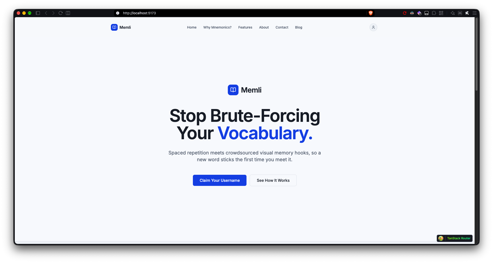
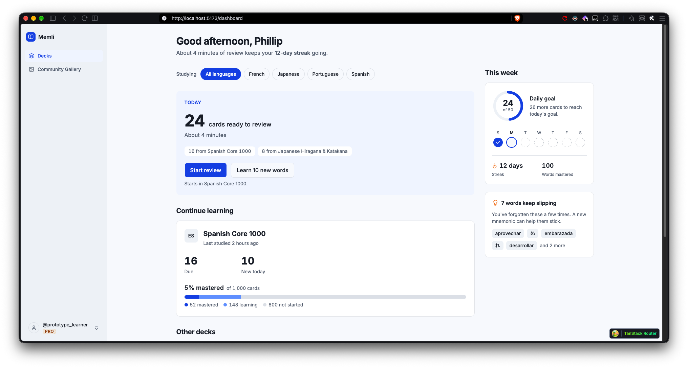

# Project & Portfolio

* **Research Notes**
* **Phillip Cantu**
* **Assignment Due Date:  Nov 9, 2026**

## Main Topic - Metrics, Analysis & Making the Business Case

Last week in `R7-Notes.md`, I wrote down the kickoff agreement with myself so I wouldn't lose the plot once the build got busy. This week is about stepping back and looking at Memli the way a stakeholder would in a surprise stand-up: _Can you actually prove this idea works, and how are you going to measure it?_

I want to be completely honest about where the app actually sits today versus where the pitch says it's going. Right now, I am still building out the frontend prototype. The marketing `landing page` and the `/dashboard` view are coming together nicely in the browser, and you can step past `/signin` into the app shell, but under the hood, it is all running on a hardcoded prototype user (`usr_prototype_01` / `@prototype_learner`). There is no Hono or Cloudflare D1 backend server wired up yet. I haven't even installed the `ts-fsrs` package into `@workspace/core` yet to calculate real spaced repetition intervals. And on top of that, I still have a lot of product and architecture decisions to figure out around how `mnemonic images` will actually be uploaded, moderated, shared, and attached across courses.

That might sound like a long list of "not done yet," but the progress is real and deliberate. Locking down the UI/UX framing and component architecture first means I'm solving the human problem before I spend days wrestling with edge database migrations or S3-compatible bucket policies.   

---

### Making the Case (An Honest Pitch)

If a stakeholder pulled me into a stand-up today and asked why Memli deserves to move forward to Beta when Anki, Duolingo, and Memrise already exist, my business case comes down to two things: **cognitive science and usability friction**.

1. **The Gap in the Market is Proven**: Old-school Memrise proved that crowdsourced visuals and narrative memory hooks make foreign vocabulary stick fast, and when they removed user-generated mnemonics, they left thousands of serious learners stranded. On the other side, Anki has rock-solid spaced repetition math, but its UI/UX is dated, intimidating, and completely non-user-friendly. Duolingo optimizes for casual daily streaks, not deep retention. Memli isn't trying to invent a brand-new behavior, instead it's combining the two pieces that actually work: community mnemonics and modern FSRS scheduling inside an interface that doesn't feel like configuring spreadsheet software.

2. **Why the Prototype-First Sequence Makes Business Sense**: In my Week 1 Change Order, I intentionally pushed real authentication (Better Auth) to Week 4 and live Backblaze B2 image uploads past the initial prototype. Why? Because nobody cares how smooth my OAuth login or image compression pipeline is if flipping a flashcard and reading a mnemonic feels clunky. By using `usr_prototype_01` and pre-seeded mnemonics first, every hour of early engineering goes straight into the core value proposition: the review loop.

## Images for Reference:

### Strengthening the Business Case: Metrics, A/B Testing & QA

Looking at my current `/dashboard` prototype screen, I already designed UI cards for the exact metrics that matter, even though the numbers are hardcoded right now:

- **Today's Queue**: `24 cards ready to review` (`About 4 minutes`) across active decks like `Spanish Core 1000` and `Japanese Hiragana & Katakana`.   
- **Leech Detection** (`7 words keep slipping`): A callout box highlighting words I keep forgetting (`aprovechar`, `embarazada`, `desarrollar`) with the prompt: _"You've forgotten these a few times. A new mnemonic can help them stick."_   
- **Progress Trends**: `Consistency (98%)`, `Retention (84% vs. Global average: 75%)`, and `New Cards (142 Added this month)`.

Right now, those numbers are static mockup data. Moving into Beta and beyond this month, turning those mockups into real analytics and validation tests is how I prove the business case works:

### 1. Product Analytics (What to Actually Track)

Instead of vanity metrics like total page views, I need to track three core learning metrics once `ts-fsrs` and the D1 database go live in Week 3:

* **Mnemonic Retention Lift:** The entire thesis of Memli is that a visual/story hook saves words that keep slipping. By comparing the FSRS retention rate and stability growth of a "leech" card *before* a user attaches/selects a mnemonic versus *after*, I can measure whether mnemonics actually beat plain rote flashcards.
* **Review Velocity & Session Completion Rate:** My dashboard promises *"About 4 minutes of review"* for 24 cards. Tracking median time-per-card and percentage of started review sessions that reach 0 due cards validates whether the React + TanStack Query optimistic UI is actually delivering the fast, zero-reload flow state promised in the proposal.
* **Mem Selection vs. Mem Creation Ratio:** Since I still have open questions around how image uploads and community sharing should work, tracking how often learners simply *pick* a pre-seeded/community mem versus clicking *"Create New Mem"* will tell me how urgent the custom Backblaze B2 upload pipeline really is.

### 2. A/B Testing Opportunities

Because I find Anki's interface overly complicated, I don't want to blindly copy Anki's controls. Two high-impact A/B tests for the beta phase are:

* **2-Button (Pass / Fail) vs. 4-Button (`Again`, `Hard`, `Good`, `Easy`) Grading:** My `ProjectProposal.md` Change Order already notes building a binary grading default with an optional 4-button dock for power users (`#51`). Testing which layout yields faster review sessions and higher 7-day retention will prove whether simplifying Anki's grading buttons reduces learner burnout.
* **Mnemonic Reveal Timing:** Testing whether showing the mnemonic image and story *immediately* when the card flips works better than hiding the mnemonic behind a "Need a hint?" toggle unless the user misses the card.

### 3. Quality Assurance (QA) & Use-Case Testing

Reading through the LogRocket breakdown on Quality Assurance (QA), the biggest takeaway for a solo developer is that QA isn't just hunting for broken buttons at the end of the month but instead it's verifying that the product actually fulfills its intended use cases cleanly and predictably. Since I am about to bridge the gap between static UI (`MS 2`) and stateful FSRS math + Hono/D1 persistence (`MS 3`), writing explicit **Use-Case QA Issues** now ensures that:

* **Use Case 1 (The SRS Review Loop)** transitions smoothly from `/dashboard` into `/study/$courseId`, grades a card via `ts-fsrs`, updates the due count optimistically, and persists to D1 without screen flicker.
* **Use Case 2 (Mnemonic Attachment — Seeded MVP)** lets a user view or swap a mnemonic on a slipping word even before the full Backblaze B2 drag-and-drop image uploader is built.

---

### What's Still Undecided (And Why That's Okay)

To keep this document honest for future-me:

* **`ts-fsrs` is still next up:** `@workspace/core` is still a stub (`#130`). All the scheduling math happens next milestone (`359 MS 3`).
* **The Backend Server isn't running yet:** Everything in the current prototype (`localhost:5173` and `localhost:5173/dashboard`) lives in `apps/web` client state under `usr_prototype_01`. Scaffolding `apps/api` with Hono and Drizzle/D1 comes in `359 MS 3` (`#106`, `#112`).
* **Mnemonic Image Architecture is still open:** I know Backblaze B2 + Cloudflare is the target stack, but I still haven't finalized aspect ratio rules, file size limits, moderation for shared community images, or whether users can remix someone else's image with their own story. Seeding static mnemonic images in Week 3 lets me test the *learning experience* of mnemonics first before locking myself into storage schemas I might regret.

---

### Issue List (Validation, Analytics & QA Issues for GitHub)

Per Step 3 of the assignment, here are the issues designed to validate the work in progress across **Analytics**, **QA Use-Case Testing**, and **UX/Mnemonic Strategy** (unassigned to a strict roadmap milestone for now, per Step 4):

#### Issue 1: `[Analytics] Instrument Core Learning Telemetry (Mnemonic Retention Lift & Session Velocity)`

* **Type:** Enhancement / Product Analytics
* **Description:**
  Currently, the `/dashboard` view displays static prototype metrics for `Retention (84%)`, `Consistency (98%)`, `24 cards ready to review (~4 minutes)`, and `7 words keep slipping`. Once `ts-fsrs` (`#130`) and the Hono/D1 review persistence endpoints (`#106`, `#112`) are wired up, we need lightweight event tracking to validate Memli's core business case.
* **What to Track & Why:**
  1. `review_event` (`cardId`, `grade`, `durationMs`, `hasActiveMnemonic`): Measures whether cards with an attached mnemonic show a statistically higher pass rate (`Good`/`Easy`) after a lapse ("leech" recovery) than cards without one.
  2. `session_summary` (`courseId`, `cardsReviewed`, `totalDurationMs`, `completedQueue`): Validates that the optimistic UI keeps review velocity near the target ~10 seconds per card (~4 minutes per 24 cards) without mid-session drop-offs.
  3. `mnemonic_interaction` (`viewed`, `swapped_seeded`, `created_custom_text`): Measures how learners interact with mnemonics so we can validate demand before building the full Backblaze B2 image upload pipeline.

#### Issue 2: `[QA / Use-Case Test] End-to-End Study Loop & FSRS State Verification`

* **Type:** Quality Assurance (QA) / Use-Case Validation
* **Description:**
  Before promoting the Beta release in `359 MS 4` (`#113`, `#114`), we need a repeatable QA use-case test suite (manual checklist + Vitest unit/integration checks) verifying **Use Case 1** (*Studying an Existing Lesson via the SRS Loop*) and the seeded slice of **Use Case 2** (*Viewing/Attaching a Mnemonic*).
* **Test Scenario Steps:**
  1. **Bypass & Entry:** Start at `/signin`, click **"Skip & Continue to Prototype →"** as `usr_prototype_01` (`@prototype_learner`), and confirm `/dashboard` renders active decks (`Spanish Core 1000`, `Japanese Hiragana & Katakana`) with accurate due counts.
  2. **Session Initiation:** Click **"Start review"** on `/dashboard` to enter `/study/$courseId`.
  3. **Reveal & Mnemonic Inspection:** Flip the active flashcard, verify the seeded visual mnemonic image and story render inside the Mnemonic Caption Overlay (`#50`) without layout shift.
  4. **Grading & FSRS Calculation:** Grade the card using the Session Grading Controls Dock (`#51`). Confirm `@workspace/core` (`ts-fsrs`) computes a valid next `due` timestamp and `stability`/`difficulty` state.
  5. **Optimistic Transition & Persistence:** Verify the next card loads immediately without a browser reload, and confirm the updated progress persists across a hard page refresh once D1 (`#112`) is connected.

#### Issue 3: `[UX Discovery / A/B Test] Define Mnemonic Sharing Rules & Compare 2-Button vs. 4-Button Grading`

* **Type:** UX Research & Product Strategy
* **Description:**
  Two major product questions remain open as we transition from static UI framing to the working SRS prototype:
  1. **Anki Friction Reduction (Grading Controls):** Does a simplified 2-button (`Pass` / `Again`) grading dock reduce cognitive fatigue compared to classic 4-button FSRS grading (`Again`, `Hard`, `Good`, `Easy`) (`#51`)?
  2. **Mnemonic Media Architecture (Post-Prototype Scope):** Before integrating direct Backblaze B2 uploads, how should user-generated mnemonic images be constrained (aspect ratio, max KB size after client compression, private-by-default vs. public community gallery, and upvote sorting)?
* **Deliverable:** Document the default grading mode for Beta and write the schema/storage constraints for community mems so `apps/api` doesn't require breaking migrations later.

---

#### Reference Links

**LogRocket Product Management** [What is Quality Assurance (QA) in Software Development?](https://blog.logrocket.com/product-management/what-is-quality-assurance-qa-software-development/)

**Memli Internal Documentation** [Project Proposal & Change Order](../ProjectProposal.md) · [Tech Stack & Change Order](../TechStack.md) · [R7 — Project Clarification & Kick Off](./R7-Notes.md)

**Algorithm Reference** [FSRS (`ts-fsrs`) Repository](https://github.com/open-spaced-repetition/ts-fsrs)
